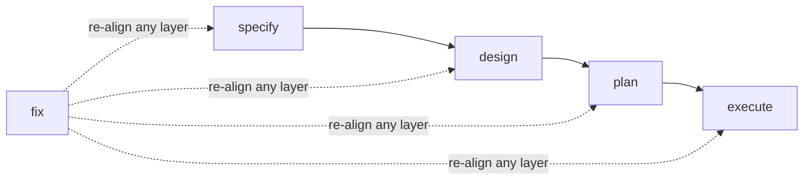

# Agent Skills

A collection of reusable agent skills, tools, and workflows designed to extend LLM capabilities and enable autonomous task execution.

## Installation

Skills are installed using the [`skills` CLI](https://github.com/vercel-labs/skills).

**Install all skills:**

```bash
npx skills add emiliosheinz/agent-skills
```

**Install a single skill:**

```bash
npx skills add emiliosheinz/agent-skills --skill <skill-name>
```

By default, skills are installed locally to the current project. Use `--global` to install them to your user directory instead, making them available across all projects.

```bash
# Local (current project only)
npx skills add emiliosheinz/agent-skills

# Global (all projects)
npx skills add emiliosheinz/agent-skills --global
```

## Available Skills

| Skill | Description |
|-------|-------------|
| `create-adr` | Writes an Architecture Decision Record (ADR) for a choice already made: its context, the decision, and the consequences. TRIGGER when: the user asks to create or write an ADR, document a decision, record why something was chosen, capture an architectural decision, or preserve the reasoning behind a finalized technical choice. SKIP for: decisions that have not been made yet (use `/create-rfc`), implementation planning or breaking work into tasks (use `/forge plan`), or general documentation that is not a decision record. |
| `create-rfc` | Writes a Request for Comments (RFC): proposes a change, compares alternatives against explicit decision criteria, and drives a decision across teams. TRIGGER when: the user asks to create or write an RFC, draft a proposal, compare options, align stakeholders, get approval for a significant change, or propose a technical/process/product/vendor/policy change before deciding. SKIP for: decisions that have already been made (use `/create-adr` to record them), implementation planning or breaking work into tasks (use `/forge plan`), or informal one-off asks that don't need stakeholder alignment. |
| `diagnose` | Root-causes a bug and saves a verified fix proposal — it diagnoses, it never fixes. Use when a bug, error, crash, exception, failing or flaky test, regression, or unexplained behavior needs root-causing — especially when it is intermittent, subtle, cross-system, or resisted a first fix. |
| `forge` | Spec-driven development from problem to shipped, verified code in four phases: `/forge specify|design|plan|execute`, plus `/forge fix` to correct course mid-stream. TRIGGER when: the user asks to ship/build/implement a feature, write a PRD or spec or requirements, design architecture, write a technical design, break work into tasks or an implementation plan, run TDD or write acceptance criteria, or correct/adjust an in-flight change — a misstated requirement, a design or implementation detail that's wrong, or a bug found while testing. SKIP for: trivial one-off edits the user already has fully specified, pure code review, or questions about how forge itself works. |
| `grill-me` | Grills the user about a plan, decision, or idea through structured AskUserQuestion rounds, until every branch of it is settled. TRIGGER when: the user says "grill me" or "grill", asks to stress-test or poke holes in their thinking, asks to be challenged on a plan or decision, or asks what they have not thought of. SKIP for: questions the codebase or the web can answer, capturing requirements for a change (use `/forge specify`), and a decision already made (use `/create-adr`). |
| `pr` | Commits, pushes, and opens a draft pull request whose body a reviewer can scan in under a minute: the problem, how it was solved, why that way. TRIGGER when: the user asks to open a PR, raise a pull request, submit work for review, write a PR body for work that has no PR yet, or says "open a pr", "pr this", "ship this for review". SKIP for: reviewing a PR's code or diff, updating or re-describing a PR that already exists, addressing review comments on a PR, writing a commit message alone, or pushing a branch without opening a PR. |
| `show-me` | Produces a compact visual of a topic — pseudocode, call tree, component tree, file tree, contract, chart, Mermaid diagram, a diff of any of those shapes, or a screenshot of a running app — built for where it will be read: a terminal, Markdown, or a self-contained HTML page. TRIGGER when: the user says "show me", asks to visualize or diagram something, asks what the shape or structure or flow of something is, or asks for a screenshot of the app; and when another skill needs a visual for a document it is writing. SKIP for: prose explanations the user asked for in words, and embedding or uploading an image anywhere — this skill produces visuals, it does not publish them. |

## Spec-Driven Development with `forge`

`forge` runs the whole decision-to-implementation pipeline as four explicit phases under
one skill, plus a `fix` command that re-enters the flow to correct course. You invoke one
phase at a time; each does its work, updates shared state, and **recommends** the next
phase without auto-running it. Depth **auto-sizes** to the change.



| Phase | Verb | Question it answers | Output |
|-------|------|---------------------|--------|
| Specify | `/forge specify <name>` | What is the problem, and what must we build? | `.specs/<slug>/spec.md` |
| Design | `/forge design` | What are the architecture, contracts, and gates for "done"? | `.specs/<slug>/design.md` |
| Plan | `/forge plan` | What are the phases of tasks, and what runs in parallel? | `.specs/<slug>/plan.md` |
| Execute | `/forge execute` | Turn the plan into verified, committed code | working code |
| Fix | `/forge fix <change>` | Something's wrong mid-stream — re-align it end-to-end | aligned artifacts + code |

### Auto-sizing

Forge adapts from one-line fixes to multi-repo refactors. The first phase to run records
the size in `state.md`; each phase scales its depth and tells you which phases to skip:

- **quick** (one file/function) — inline spec → `execute` (skip design and plan)
- **standard** (one component) — full spec → light design → phased plan → execute
- **complex** (crosses components/repos) — the full pipeline with every gate

### Flexible entry points

Start at whichever phase fits — a verb with no prior artifacts derives just enough context
to do its job. `/forge specify` for a fresh problem, `/forge design` when requirements are
already clear, `/forge plan` straight from a known design, `/forge execute` for a small
change.

### Lateral skills

`/create-rfc` and `/create-adr` are not tied to any phase — use them whenever a significant
decision needs proposing or recording.

- **Decision** — `/create-rfc`: should we do X or Y? Which approach?
- **Record** — `/create-adr`: why did we choose X over Y?
