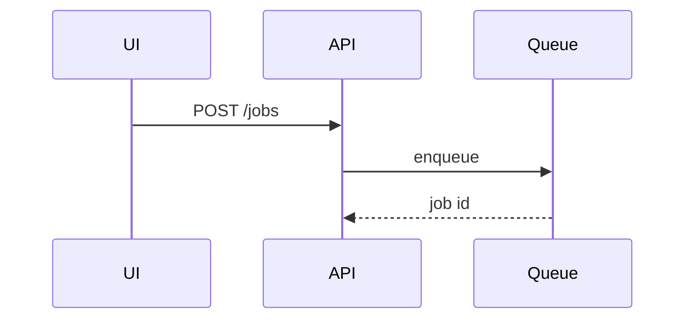

# Composition

How the body takes its shape. There is no template to fill — the structure is **born
from the change**. Two decisions, in order: how much explanation the change earns
(tier), and which views carry it (catalog).

## The spine

Exactly one element is always present:

**The why sentence.** One sentence, first line, stating the problem this solves or what
becomes possible once it ships. Not what the code does — why anyone wanted it.

```text
Token refresh silently failed after a 401, so users were logged out mid-session.
Sessions longer than an hour were unusable on mobile.
```

Everything else earns its place or does not appear. There is no "Summary" heading on a
one-sentence PR, no "Testing" heading when the test output is one line, no "Changes"
heading followed by the file list GitHub already renders.

## Tiers

Size the PR by how much a reviewer has to **reconstruct in their head**, not by lines
changed. A 400-line mechanical rename is `quick`. A 30-line change to a shared auth path
is not.

When `./.specs/<slug>/state.md` records a `Size:`, seed the tier from it — then override
upward if the diff shows something the size missed (a migration, a shared contract, a
one-way door).

### quick

One sentence. Evidence if the change is observable. Nothing else.

> Fixes the typo in the onboarding email subject line.
>
>  

That is a complete, finished PR description. Adding headings to it makes it worse.

**Triggers:** typo, copy change, dependency bump, config flip, single-function fix, a
rename with no behavior change.

### standard

The why sentence, then:

- **One view** — the smallest one that shows the shape of the change (catalog below).
- **Evidence** — before/after for anything observable.
- **0–3 "worth knowing" bullets** — only genuine reviewer warnings: a migration, a
  compatibility constraint, something deliberately left out, a decision that will look
  wrong without the reason. No bullets qualify → no bullets. Never pad to three.

Headings are optional even here. If the whole body is a sentence, a diagram and two
bullets, it reads better with no headings at all.

**Triggers:** a new endpoint, a component, a contained bug fix with a real cause, one
module's worth of change.

### complex

The why sentence, then **tell the story in the order that makes it understandable** —
named after the change, not after a template. Several views, each next to the short text
it supports. Evidence. A risk section when the change is a one-way door.

Order follows the dependency of understanding, not the file tree. Often:

1. the contract, schema, or data shape that everything else assumes;
2. the flow through it;
3. where the code now lives;
4. what a reviewer should be suspicious of.

Section headings are named for *this* change — `## The new event shape`,
`## Why the retry moved to the client` — never `## Technical Details`.

**Triggers:** a refactor across modules, a migration, a new subsystem, a change to a
contract other code depends on, anything crossing a service boundary.

## View catalog

Pick the **smallest view that makes the point**. One is usually enough; three is almost
always too many. Omit any category that did not change.

Use a `diff` block when the surrounding shape already exists and the point is what
changed. Show the complete shape when most of it is new, or when diff markers would
hide ownership or order.

**Logic or an algorithm — pseudocode:**

```text
on(save)
  if content is unchanged
    return cached result
  write new content
```

**Runtime control flow — call tree:**

```diff
 submitForm
   createSession
+    expandSkillMention
     launchAgent
```

**UI structure — component tree,** with the state and module boundaries that matter:

```diff
 <SessionPage> (apps/web/src/routes/session.tsx)
   useSessionEvents()
   <SessionToolbar>
+    <RunSkillButton />   (packages/ui)
```

**Responsibility or a broad refactor — shallow file tree:**

```diff
 src/
 ├── commands/       # parses user actions
-└── transport.ts
+└── transport/
+    ├── client.ts   # sends requests
+    └── stream.ts   # holds the SSE connection
```

**Interaction, data flow, or a sequence across systems — Mermaid:**

````text

````

When `forge` produced a diagram in `design.md`, reuse it rather than drawing a new one.

**A contract — the request/response or table shape:**

```diff
 POST /sessions
   { promptId: string
+  , skillName?: string
   }
```

**A key type or data structure** that the rest of the change assumes — show it whole,
in the project's language, when it is new.

### Choosing

Ask what the reviewer has to hold in their head to judge the diff:

| They need to know | View |
|---|---|
| what the logic now decides | pseudocode |
| what calls what now | call tree |
| what renders where, and what owns state | component tree |
| where code moved and what each part owns | file tree |
| how systems talk, in order | Mermaid sequence |
| what the wire or table shape is | contract diff |
| what the new shape is, exactly | whole block |

None of these help → the change is probably `quick`. Write the sentence and stop.

## Evidence placement

Evidence goes next to the claim it proves, not in a trailing appendix. A before/after
pair directly under the why sentence is often the entire body of a UI PR.

## Risk

One inline line, near the end, always:

```text
Risk: two-way door · local
```

- **Door** — can this be walked back after merge? Irreversible or expensive to undo
  (data migration, deletion, a message sent to real users, a published artifact) is a
  **one-way door**. Everything a revert fixes is a **two-way door**.
- **Blast radius** — one word for how far it reaches: `local`, `module`, `service`,
  `product`, `data`.

It is promoted from a line to a short **section** only when the door is one-way or the
blast radius is wider than the module touched. Then name the specific irreversible step
and what a reviewer should verify before approving. On a two-way/local change the single
line is the whole point — it tells the reviewer they can skim.

## Worked example — standard

````markdown
Refresh tokens were dropped on a 401, logging users out mid-session.

The retry now runs before the error surfaces, so a single expired access token is
invisible to the caller.

```diff
 request(url)
   response = fetch(url)
-  if 401 then throw
+  if 401
+    refresh()
+    response = fetch(url)   # once, then throw
   return response
```

- The refresh is attempted once. A second 401 still logs out, deliberately — a refresh
  loop against a revoked session is worse than a logout.

Evidence: `src/auth/refresh.test.ts` — 4 new cases, including the second-401 path.

Risk: two-way door · module
````

Note what is absent: no "Summary" heading, no file list, no "Testing" section, no
restatement of the diff.
