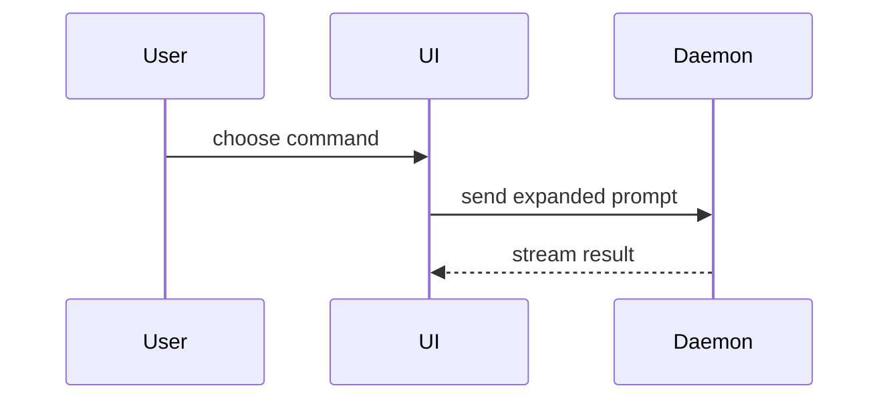

# Show me

Make the topic visible. Skip the preamble and keep prose brief. Pick the
smallest view that makes the key point clear, and build it for the surface it
will be read on.

This skill **produces** visuals. It does not embed, upload or publish them —
the caller does that.

## Parameters

Callers may constrain the output. Each is optional except the topic.

| Parameter | Meaning | Default |
|-----------|---------|---------|
| topic | What to make visible. Required. | — |
| `surface` | Where the view will be read: `terminal`, `markdown`, or `html`. | `terminal` |
| `max-views` | Ceiling on how many views to return | your judgement |
| `size` | `tight` keeps every view under roughly 12 lines, dropping any detail that is not load-bearing. `normal` keeps what the topic needs. | `normal` |

`/pr` calls this with `surface: markdown`, `size: tight` and a low
`max-views`, because a PR body is scanned rather than studied.

## Surfaces

The surface decides which primitives exist. Getting it wrong is the one
mistake that ruins an otherwise good view.

| `surface` | Read in | What it can do |
|-----------|---------|----------------|
| `terminal` | Claude Code and any CLI | Text. Color comes from the fence language, borders from tables, series from fill texture. A diagram renders only where a Mermaid renderer is present. |
| `markdown` | GitHub PRs, issues, READMEs | Mermaid renders and takes color. `<table><td>` gives real columns. `<details>` folds. `> [!NOTE]` calls out. |
| `html` | A published Artifact page | Real layout, CSS, charts and diagrams. Returned as a file path for the caller to publish. |

**Read [references/surfaces.md](references/surfaces.md) for the surface you
were given before producing anything.** It holds the fence-to-color map, the
safe glyph set, what GitHub's sanitizer keeps, and the rules for an HTML page.

A raw Mermaid fence in a terminal is a wall of source, which is the opposite
of the job. `surfaces.md` has the cascade that decides whether to render it,
emit it, or drop it for a text view.

## Composition

How the views sit together matters as much as each one.

- **One headline view** carries the answer, and it comes first. Everything
  after it is support.
- **Ceiling:** one view at `tight`, at most three at `normal`. A fourth means
  you are writing a document, not showing a shape.
- **One question per view.** A view answering two questions is two views, or
  one hairball.
- **Caption each view with its finding**, on the line above it — "state.md is
  the only shared write", not "Architecture". A caption naming the view's
  category tells the reader nothing they cannot see.
- **No two adjacent views of the same shape.** Two trees in a row read as one
  long tree.
- **Twelve nodes to a diagram**, split at twenty. The ceiling binds harder
  than it feels like it should — see
  [references/diagrams.md](references/diagrams.md).

## The views

**Logic or an algorithm — pseudocode:**

```py
on(save)
  if content is unchanged
    return cached result
  write new content
  return fresh result
```

**Runtime control flow or order — call tree:**

```text
submitForm
  createSession
    persistPrompt
    launchAgent
  navigateToSession
```

**UI structure — component tree**, including the state and module boundaries
that matter:

```tsx
<SessionPage> (apps/example/src/routes/session.tsx)
  useSessionEvents()
  <SessionToolbar>
    <RunSkillButton> (packages/ui)
```

**File responsibility, or a broad refactor — shallow file tree:**

```text
src/
├── commands/       # parses user actions
├── sessions/       # owns session state
└── transport/      # sends API requests
```

**Counts, durations, sizes, proportions — a chart.** Numbers buried in prose
are numbers nobody compares. On `terminal`, bars built from block characters;
on `markdown`, a Mermaid `pie`; on `html`, a real chart. Recipes per surface
live in [references/surfaces.md](references/surfaces.md).

```text
specify  ████████████████████                      2 reviewers
design   ████████████████████████████████████████  4 lenses
execute  ██████████████████████████████████████████████████  5 verifiers
```

**Component interaction, control flow, or data flow — Mermaid**, on a surface
that renders it. Drawing one has its own checklist, below.



**Mostly new code, or where omitted context would hide ownership or order, or
where the reader needs a copyable target shape — the whole block:**

```ts
function expandSkill(command: string): string {
  const skillName = command.slice(1)
  return `use the ${skillName} skill`
}
```

**An endpoint's request/response, or a table's columns — the contract:**

```http
POST /sessions
  → { email, password }
  ← 201 { sessionId, expiresAt }
  ← 401 { error: "invalid_credentials" }
```

**A key type or data structure that changed shape — diff the type:**

```diff
 type Session = {
   id: string
-  legacyToken: string
+  idpSub: string
+  expiresAt: Date
 }
```

## Diffing a shape

Use `diff` when the point is what changes and the surrounding shape already
exists. **Match the diff shape to the topic** — diff the component tree, the
file tree, the call tree or the pseudocode. A literal source diff is not a
view; the reader can already read the source diff.

A component change:

```diff
 <SessionPage>
   useSessionEvents()
   <SessionToolbar>
+    <RunSkillButton />
   <SessionTimeline>
+    <SkillResultCard />
```

A file-layout change:

```diff
 src/
 ├── commands/
+│   └── show-me.ts       # expands the slash command
 ├── sessions/
-└── transport.ts
+└── transport/
+    ├── client.ts
+    └── stream.ts
```

A call-tree change:

```diff
 submitForm
   createSession
     persistPrompt
+    expandSkillMention
     launchAgent
   navigateToSession
+    subscribeToEvents
```

A state or control-flow change:

```diff
 on(save)
-  write content
+  if content is unchanged
+    return cached result
+  write new content
+  invalidate cache
```

The `diff` fence is also the only way to get red and green into a terminal, so
prefer it wherever the topic genuinely is a change.

## Screenshots

For a change to something the reader would want to *see* — a UI, a layout, a
visual state — a screenshot of the real thing beats any text view.

1. Get the app running. If the project has a skill for launching it, use that.
2. Drive it to the state that matters with Playwright or the browser
   extension, whichever the session has.
3. Capture to a file outside the repo, and **return the path**. Capture the
   state it changed from as well, when the comparison is the point.

Never commit a screenshot into the repository. Embedding, uploading and
hosting belong to whoever asked for the visual.

If the app cannot be run or driven, say so plainly and offer the nearest text
view. Do not hand-write a mock of a UI that exists.

A screenshot is an image, so it cannot be the view on `terminal`. Return the
path and name what it shows.

## Drawing a diagram

Copy this checklist and work it in order. Steps 1 and 4 are what keep a
diagram honest; step 3 is what keeps it from arriving broken.

```text
- [ ] Enumerate the nodes, and the edges as `source --verb--> target`
- [ ] Draw only what is enumerated, 12 nodes or fewer
- [ ] Validate: node show-me/scripts/validate-mermaid.mjs <file>
- [ ] Read the drawn diagram back against the enumeration
```

**Run** `scripts/validate-mermaid.mjs`; there is no reason to read it. It exits
0 when every diagram parsed, 1 when one did not — with the failing line and
the tokens the parser accepts there — and 2 when it could not run at all, in
which case check the diagram by hand and say validation was skipped. It needs
`node` and `npm`.

The ceilings, the diagram-type menu, the palette and the syntax that fails
silently are all in [references/diagrams.md](references/diagrams.md).

## Guidance

Place each visual next to the short text it supports. Keep only the calls,
files, props, states and boundaries needed to answer the question actually
being asked.

Each view must add information rather than repeat the prose. A view that
restates the sentence above it is noise with syntax highlighting.

You may use one of these, you may use several, you will rarely use all of
them. Keep the views whose information the prose does not already carry, and
drop the rest.

Before returning, read the output as the reader will: **the headline has to
land from the first view alone, without the prose around it.** If it does not,
the wrong view is first, or the caption is not saying the finding.

Renderers fail silently in both directions, which is why the checklist above
is not optional: a broken diagram looks fine from here, and a diagram that
renders beautifully can still be missing half its edges.

## Credits

Adapted from Dex Horthy's `show-me` (HumanLayer), MIT licensed. See
`CREDITS.md`.
