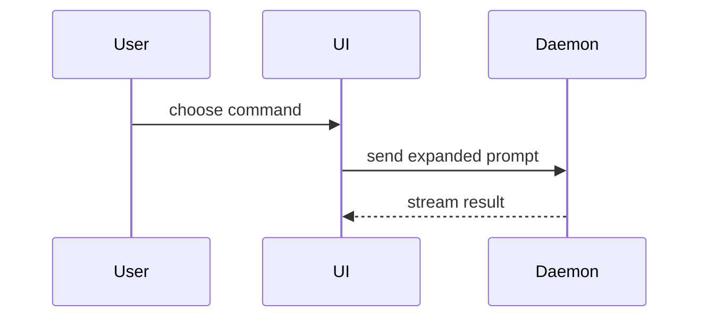

# Show me

Make the topic visible. Skip the preamble and keep prose brief. Pick the
smallest view that makes the key point clear.

This skill **produces** visuals. It does not embed, upload or publish them —
the caller does that.

## Parameters

Callers may constrain the output. Each is optional except the topic.

| Parameter | Meaning | Default |
|-----------|---------|---------|
| topic | What to make visible. Required. | — |
| `max-views` | Ceiling on how many views to return | your judgement |
| `size` | `tight` keeps every view under roughly 12 lines, dropping any detail that is not load-bearing. `normal` keeps what the topic needs. | `normal` |

`/pr` calls this with `size: tight` and a low `max-views`, because a PR body is
scanned rather than studied.

## The views

**Logic or an algorithm — pseudocode:**

```text
on(save)
  if content is unchanged
    return cached result
  write new content
  return fresh result
```

**Runtime control flow or order — call tree:**

```text
submitForm
  createSession
    persistPrompt
    launchAgent
  navigateToSession
```

**UI structure — component tree**, including the state and module boundaries
that matter:

```tsx
<SessionPage> (apps/example/src/routes/session.tsx)
  useSessionEvents()
  <SessionToolbar>
    <RunSkillButton> (packages/ui)
```

**File responsibility, or a broad refactor — shallow file tree:**

```text
src/
├── commands/       # parses user actions
├── sessions/       # owns session state
└── transport/      # sends API requests
```

**Component interaction, control flow, or data flow — Mermaid:**



**Mostly new code, or where omitted context would hide ownership or order, or
where the reader needs a copyable target shape — the whole block:**

```ts
function expandSkill(command: string): string {
  const skillName = command.slice(1)
  return `use the ${skillName} skill`
}
```

**An endpoint's request/response, or a table's columns — the contract:**

```text
POST /sessions
  → { email, password }
  ← 201 { sessionId, expiresAt }
  ← 401 { error: "invalid_credentials" }
```

**A key type or data structure that changed shape — diff the type:**

```diff
 type Session = {
   id: string
-  legacyToken: string
+  idpSub: string
+  expiresAt: Date
 }
```

## Diffing a shape

Use `diff` when the point is what changes and the surrounding shape already
exists. **Match the diff shape to the topic** — diff the component tree, the
file tree, the call tree or the pseudocode. A literal source diff is not a
view; the reader can already read the source diff.

A component change:

```diff
 <SessionPage>
   useSessionEvents()
   <SessionToolbar>
+    <RunSkillButton />
   <SessionTimeline>
+    <SkillResultCard />
```

A file-layout change:

```diff
 src/
 ├── commands/
+│   └── show-me.ts       # expands the slash command
 ├── sessions/
-└── transport.ts
+└── transport/
+    ├── client.ts
+    └── stream.ts
```

A call-tree change:

```diff
 submitForm
   createSession
     persistPrompt
+    expandSkillMention
     launchAgent
   navigateToSession
+    subscribeToEvents
```

A state or control-flow change:

```diff
 on(save)
-  write content
+  if content is unchanged
+    return cached result
+  write new content
+  invalidate cache
```

## Screenshots

For a change to something the reader would want to *see* — a UI, a layout, a
visual state — a screenshot of the real thing beats any text view.

1. Get the app running. If the project has a skill for launching it, use that.
2. Drive it to the state that matters with Playwright or the browser
   extension, whichever the session has.
3. Capture to a file outside the repo, and **return the path**. Capture the
   state it changed from as well, when the comparison is the point.

Never commit a screenshot into the repository. Embedding, uploading and
hosting belong to whoever asked for the visual.

If the app cannot be run or driven, say so plainly and offer the nearest text
view. Do not hand-write a mock of a UI that exists.

## Guidance

Place each visual next to the short text it supports. Keep only the calls,
files, props, states and boundaries needed to answer the question actually
being asked.

Each view must add information rather than repeat the prose. A view that
restates the sentence above it is noise with syntax highlighting.

You may use one of these, you may use several, you will rarely use all of
them. Use your judgement and do not overwhelm the reader.

## Credits

Adapted from Dex Horthy's `show-me` (HumanLayer), MIT licensed. See
`CREDITS.md`.
