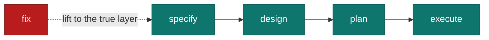
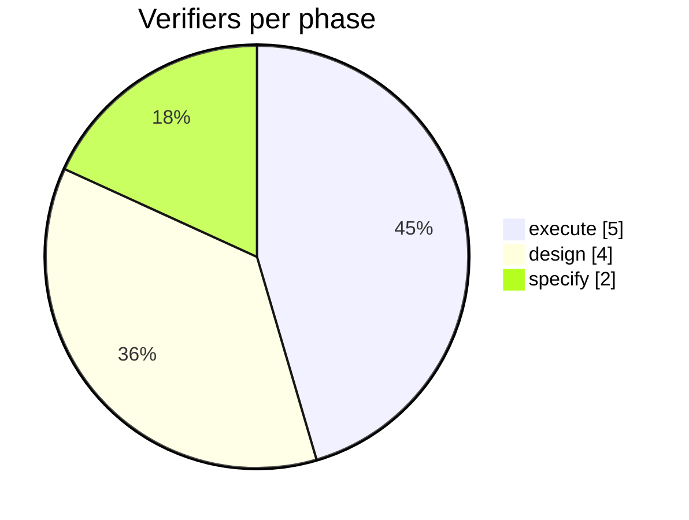

# Surfaces

Three places a view gets read, with near-opposite strengths. Read the section
for the `surface` you were given before producing anything.

| Primitive | `terminal` | `markdown` | `html` |
|-----------|------------|------------|--------|
| Mermaid | source only | renders | renders |
| Color inside a block | by fence language | by fence language | full CSS |
| Tables | renders bordered | renders | renders |
| Box drawing, block bars | yes | yes | yes |
| Collapsing a long view | no | `<details>` | yes |
| Callout bar | no | `> [!NOTE]` | yes |
| Images | no | yes | yes |
| Width | 80 columns, hard | wide | wide |

A view built for the wrong surface is the failure this file exists to prevent.
Mermaid sent to a terminal is a wall of source. An 80-column box diagram sent
to an HTML page wastes the page.

## terminal

Claude Code renders Markdown but no diagrams. Everything is monospace text,
so structure and color have to come from the two things it does render:
**fence syntax highlighting** and **Markdown tables**.

### Fence language is the color channel

A `text` fence is gray. Pick the language that colors the part the eye should
land on.

| The view is | Fence | What it colors |
|-------------|-------|----------------|
| Anything added, removed or changed | `diff` | added lines green, removed red |
| Pseudocode | `py` | `if`, `return`, `for`, `while`, `in` |
| An endpoint contract | `http` | the method and the status codes |
| Key-to-value pairs, a config shape | `ini` | keys apart from values |
| A payload or a record | `json` | strings, numbers, booleans |
| Commands and flags | `bash` | the command apart from its arguments |
| Real code | its own language | types and keywords |
| A call tree, a file tree, bars, a panel | `text` | nothing — no tokens to color |

Never leave a view in `text` when a real language fits it. That single choice
is the difference between a gray block and a lit one.

In a `diff` fence, every unchanged line needs a leading space. Without it the
highlighter reads the line as a header and the colors go wrong.

### Tables are the only bordered primitive

When a view is really a small matrix — per-phase, per-file, per-state — a
table beats drawn boxes. It gets real borders, it aligns, and it never wraps
into garbage.

Right-align numeric columns with `---:`.

### Bars for quantity

Scale the longest bar to 40 columns and keep labels short enough to stay under
80 total. `█` is one unit, `▌` a half unit.

```text
specify  ████████████████████                      2 reviewers
design   ████████████████████████████████████████  4 lenses
execute  ██████████████████████████████████████████████████  5 verifiers
```

### Panels for flow

One line weight per view — never mix `─` with `═`. The vocabulary:
`─ │ ┌ ┐ └ ┘ ├ ┤ ┬ ┴ ┼ ▶ ◀ ▲ ▼`.

```text
  specify ──▶ design ──▶ plan ──▶ execute
     │          │         │         │
     └──────────┴────┬────┴─────────┘
                     ▼
               state.md (hub)
```

### The width budget

80 columns, no exceptions. A box diagram that wraps is worse than no diagram —
the reader cannot even tell what it was. Count the longest line before you
return it. Too wide means a different view, not a smaller font.

## markdown

GitHub renders Mermaid, so the diagram views are live here. The failure mode
is different: diagrams that render but look like default gray boxes, and
bodies that stack four of them with nothing to scan.

### Style every Mermaid diagram

GitHub picks the Mermaid theme from the reader's light or dark setting, and an
unstyled node is a gray box in both. Give the nodes meaning with color.



The palette, dark enough that white text reads on it in either theme:

```text
classDef primary fill:#1e40af,stroke:#1e3a8a,color:#fff
classDef work    fill:#0f766e,stroke:#115e59,color:#fff
classDef state   fill:#6d28d9,stroke:#5b21b6,color:#fff
classDef danger  fill:#b91c1c,stroke:#7f1d1d,color:#fff
classDef muted   fill:#334155,stroke:#1e293b,color:#fff
```

Always set all three of `fill`, `stroke` and `color` together. A `fill` without
a `color` is unreadable in whichever theme you did not check.

Never set the theme with `%%{init: {'theme': ...}}%%`. It overrides GitHub's
light-and-dark switching, so fixing one theme breaks the other.

Color carries emphasis, never information on its own — the node's label still
has to say what it is.

### One question per diagram

A flowchart holding the pipeline, the artifacts it emits, the shared state hub
and the re-entry paths answers four questions and reads as a hairball. Split
it, or drop the parts the reader did not ask about. Two diagrams of five nodes
beat one of twenty.

Pick `LR` for a pipeline, `TD` for a hierarchy or a decision. Use `subgraph`
only when the grouping is itself part of the answer.

### Quantity

`pie` is the safe quantitative diagram — stable, and it renders everywhere
GitHub renders Mermaid.



For a series across an axis, `xychart-beta` renders on current GitHub; confirm
it once on the host that matters before a body depends on it. Where it is not
certain, a table of bars built the `terminal` way renders identically in
Markdown and cannot fail.

### Fold the long view

When the compact view is the answer and the full one is reference, give the
reader both without the wall:

````text
<details>
<summary>Full call tree</summary>

```text
submitForm
  createSession
```

</details>
````

### Call out the invariant

One `> [!NOTE]` or `> [!IMPORTANT]` per output, holding the single line the
reader must not miss. A second one spends the emphasis of the first.

## html

A self-contained page, published as an Artifact by whoever asked for it. This
is the surface with real layout, real color and real diagrams — so it is also
the one to resist. Reach for it only when the view genuinely exceeds the other
two: more nodes than 80 columns can hold, more than one dimension at once, or
something the reader will return to rather than scroll past.

A six-line call tree does not need a web page.

1. Load the `artifact-design` skill before writing the file. Load
   `artifact-diagramming` as well if the page carries a diagram, and `dataviz`
   if it carries a chart.
2. Write page content only — no doctype, `html`, `head` or `body` tags; the
   publisher wraps the file. Put the `<title>` and the `<style>` at the top.
3. Mermaid renders natively in a published Artifact through
   `<pre class="mermaid">`. Do not load a Mermaid library.
4. Write the file into the session scratchpad, never into the repository, and
   **return the absolute path**.

Publishing is the caller's job, exactly as it is for a screenshot. When no
other skill asked for the visual, the one who invoked you is the caller:
publish the file with the Artifact tool and hand back the link.
