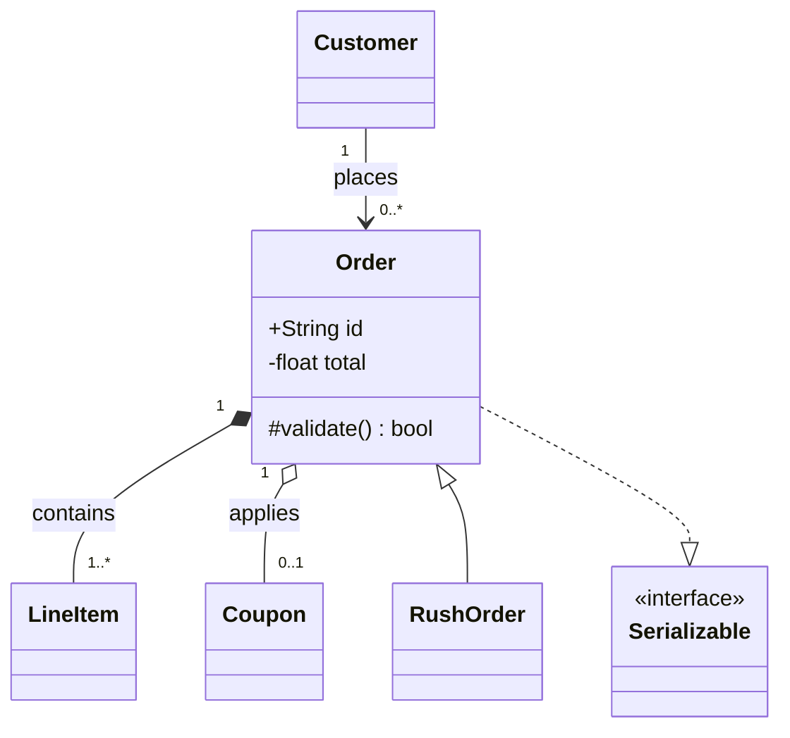
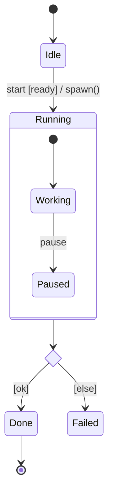

# UML

When a subject has a UML diagram type, draw that type and use its notation
correctly. A diagram that looks like a class diagram but misuses the diamond
is worse than prose, because the reader trusts the notation and the notation
is lying.

Readers follow the conventions of a notation they recognise over any generic
layout aesthetic, so a UML subject drawn in ad-hoc boxes forfeits the
comprehension the convention already buys.

- [What is and is not a UML subject](#what-is-and-is-not-a-uml-subject)
- [Picking the type](#picking-the-type)
- [Class diagrams](#class-diagrams)
- [Sequence diagrams](#sequence-diagrams)
- [State machine diagrams](#state-machine-diagrams)
- [Use case diagrams](#use-case-diagrams)
- [Activity diagrams](#activity-diagrams)
- [Gotchas](#gotchas)

## What is and is not a UML subject

UML covers structure and behaviour of a system. It does not cover everything
this skill draws, and forcing a non-UML subject into UML makes it worse.

| Subject | Treatment |
|---------|-----------|
| Classes, types, data model | Class diagram |
| An exchange between participants over time | Sequence diagram |
| Modes and transitions of one object | State machine diagram |
| Goals of actors against a system | Use case diagram |
| A workflow or algorithm | Activity diagram |
| Deployed units and their interfaces | Component or deployment diagram |
| A file tree, a call tree, a chart, a screenshot, an endpoint contract, a repository history | **Not UML.** Use the plain view and do not dress it as UML |

When the subject is not UML, say nothing about UML — do not apologise for it,
and do not invent a stereotype to make a file tree look conformant.

## Picking the type

Mermaid implements part of UML and nothing fills the rest. Every row below was
checked against Mermaid's own parser.

| UML diagram | Mermaid | Fidelity gap |
|-------------|---------|--------------|
| Class | `classDiagram` | Full enough: all six relationships, visibility, multiplicity, stereotypes |
| Sequence | `sequenceDiagram` | Full enough: lifelines, execution specifications, combined fragments, create and destroy |
| State machine | `stateDiagram-v2` | Good: initial, final, composite, choice, fork, join. No history pseudostate |
| Use case | `usecase-beta` | Actors, system boundaries and links only. No «include» / «extend» stereotype rendering |
| Activity | `flowchart` | Approximation only — see below |
| Component | **none** | Mermaid cannot draw provided and required interfaces. Use a `flowchart` and say it is not a component diagram |
| Deployment, object, package, timing, communication | **none** | Same: approximate honestly or use prose |

## Class diagrams

Mermaid's arrow glyphs map onto UML's as follows. The end carrying the
ornament matters: write the **whole on the left** for aggregation and
composition, and the **subtype on the right** for generalization.

| UML relationship | Notation | Mermaid |
|------------------|----------|---------|
| Generalization | Solid line, hollow triangle at the supertype | `Super <|-- Sub` |
| Realization | Dashed line, hollow triangle at the interface | `Impl ..|> Interface` |
| Composition | Solid line, filled diamond at the composite | `Whole *-- Part` |
| Aggregation | Solid line, hollow diamond at the aggregate | `Whole o-- Part` |
| Directed association | Solid line, open arrowhead | `A --> B` |
| Association | Plain solid line | `A -- B` |
| Dependency | Dashed line, open arrowhead at the supplier | `Client ..> Supplier` |

Rules that are part of the notation, not decoration:

- **Visibility on every member**: `+` public, `-` private, `#` protected,
  `~` package.
- **Multiplicity on both ends** of an association: `1`, `0..1`, `*`, `1..*`.
  An association with no multiplicity is an unfinished diagram.
- **Name the association** with a verb, or give the ends role names.
- **Composition means the part cannot outlive the whole.** Use aggregation
  when it can. Choosing the filled diamond by default is the most common
  class-diagram error.
- Abstract operations take `*`, static members take `$`, and
  `<<interface>>` or `<<abstract>>` goes on its own line inside the class.



## Sequence diagrams

| UML message | Notation | Mermaid |
|-------------|----------|---------|
| Synchronous call | Solid line, filled arrowhead | `A->>B: op()` |
| Asynchronous signal | Solid line, open arrowhead | `A-)B: signal()` |
| Reply | **Dashed** line, open arrowhead | `A-->>B: result` |
| Create | Dashed arrow to the lifeline head | `create participant X` |
| Destroy | Cross at the end of the lifeline | `destroy X` |
| Execution specification | Thin bar on the lifeline | `A->>+B:` … `B-->>-A:` |

- **Every call that returns a value gets a dashed reply.** A sequence diagram
  of solid arrows only is asserting that nothing ever answers.
- **Guards go in square brackets**, conditions on combined fragments.
- Combined fragments all parse: `alt`/`else`, `opt`, `loop`, `par`/`and`,
  `critical`, `break`. Use `alt` for mutually exclusive branches and `opt` for
  a single optional one — they are not interchangeable.
- Prefer the inline `+`/`-` form over separate `activate`/`deactivate` lines.
  Pairing them is the single weakest axis in generated Mermaid sequence
  diagrams, and the inline form cannot be left unbalanced.

## State machine diagrams

The transition label has a defined grammar — **`trigger [guard] / effect`** —
and all three parts are optional but the order is not.



- `[*]` serves as both the initial pseudostate and the final state; which one
  it is reads from the arrow direction.
- Entry and exit behaviours go on their own description lines:
  `Active : entry / openSocket()`.
- `<<choice>>`, `<<fork>>` and `<<join>>` exist. History pseudostates do not —
  if the machine needs `H`, say so in the caption.
- A state machine describes **one** object's lifecycle. Two objects' states in
  one diagram is the abstraction-salad anti-pattern wearing UML.

## Use case diagrams

Use cases are goals an actor achieves, named as verb phrases from the actor's
point of view — "Place order", not "Order processing" and not "OrderService".

```mermaid
usecase-beta
actor Customer
systemBoundary Shop
end
Customer --> PlaceOrder
```

- **Keywords must start at column 0.** Any leading indentation is a parse
  error, which is unusual among Mermaid diagram types and easy to miss.
- «include» points from the base use case to the included one; «extend»
  points from the extension back to the base. Mermaid renders neither
  stereotype, so put the direction in the link label and keep it correct.
- Actors are roles, not people or systems-you-own. The system under
  discussion is the boundary, never an actor inside it.

## Activity diagrams

Mermaid has no activity diagram. A `flowchart` approximates one, and the
approximation is honest only if the conventions that *can* carry do carry:

- A diamond for every decision, with **bracketed guards on each outgoing
  edge** — `-->|"[in stock]"|`.
- A merge where branches rejoin, rather than arrows converging on an action.
- An initial node and an activity final node, so the start and end are marked
  rather than implied.
- `subgraph` as the stand-in for a partition, named for the responsible party.

What the approximation cannot express: fork and join of concurrent flows as
bars, flow-final versus activity-final, and object nodes. If the subject needs
those, say the diagram is a simplification rather than letting the reader
assume full activity semantics.

## Gotchas

- **`erDiagram` is not UML.** It draws crow's-foot entity relationship
  notation. UML models data with a class diagram. Either is fine; do not call
  an ER diagram a UML diagram.
- **`flowchart` is not UML either**, and most "UML" flowcharts on the internet
  are activity diagrams drawn badly.
- `classDef` is a no-op on `classDiagram` — use `style`. It is also a no-op on
  `sequenceDiagram`, where `box` groups participants.
- Quote any label holding parentheses, which operation signatures always do.
- Validate before returning:
  `node show-me/scripts/validate-mermaid.mjs <file>`.
